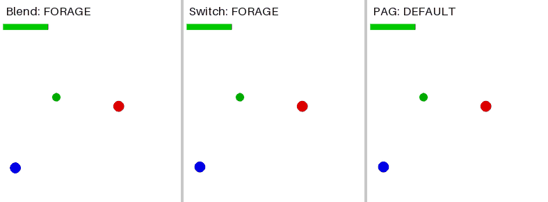
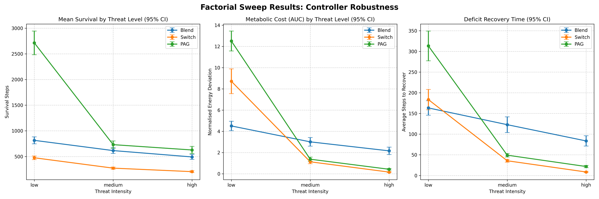
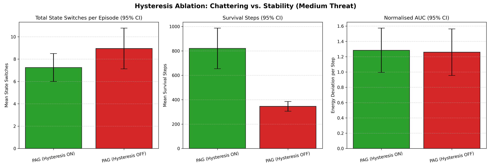
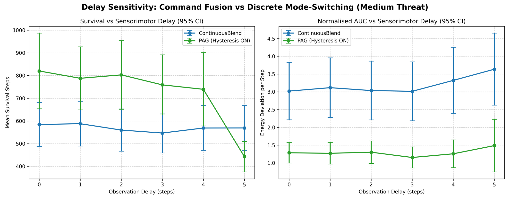
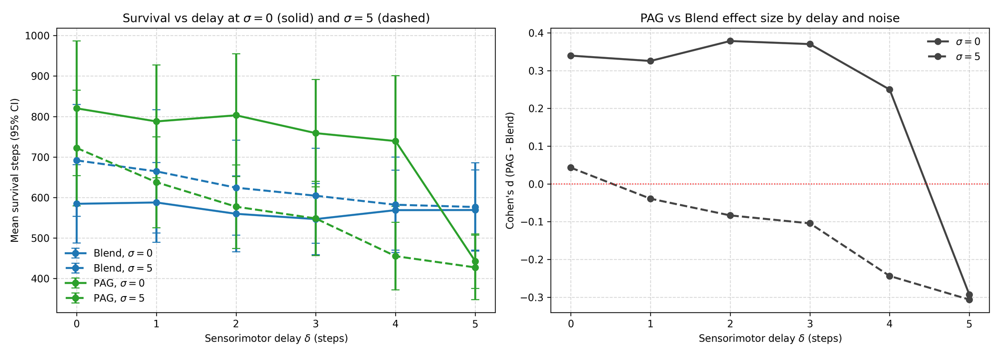
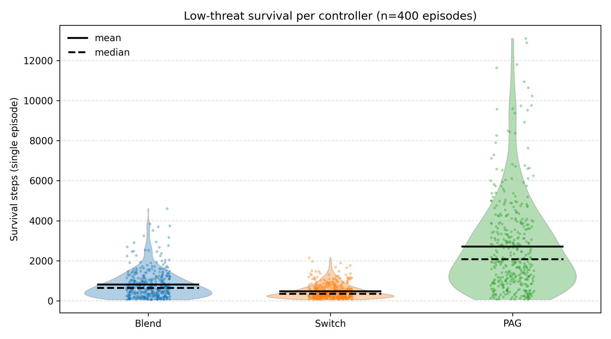

# pag-arbitration

[](https://github.com/TomParkin1/pag-arbitration/actions/workflows/ci.yml)
[](LICENSE)
[](pyproject.toml)

**Should a robot under threat blend its goals, or switch between them?** This
repository is a reproducible simulation study comparing three ways for an
agent to arbitrate between foraging and avoiding a predator. One of them is a
discrete state machine inspired by the defensive modes of the midbrain
periaqueductal grey (PAG).

It was my BSc Computer Science dissertation project at the University of
Sheffield (2026), supervised by Prof. Tony Prescott.



*The same world (seed 1046) under each controller. Blue is the agent, red the
predator and green the food. BLEND and SWITCH are caught. PAG freezes when the
predator comes near, which shrinks the predator's detection range, and it is
still alive at the end of the clip.*

## Contents
- [Motivation](#motivation)
- [Features](#features)
- [Key results](#key-results)
- [Quickstart](#quickstart)
- [Reproducing the dissertation](#reproducing-the-dissertation)
- [How it works](#how-it-works)
- [Design decisions](#design-decisions)
- [Project structure](#project-structure)
- [Limitations and future work](#limitations-and-future-work)
- [Citation](#citation)

## Motivation

Any autonomous agent with more than one goal needs an *arbitration* rule to
decide what to do when those goals conflict. A common engineering answer is
to **blend**: weight each behaviour's command by how urgent it is and add the
commands together. Under survival pressure, though, averaging "run to the food"
with "run from the predator" can produce a compromise that does neither well.

Animals seem to solve the problem differently. The PAG selects qualitatively
distinct defensive modes, such as freezing or fleeing, according to how close
the threat is.

The project asks three questions:

1. **RQ1:** Does discrete mode switching help an agent survive longer than
   blending as threat increases?
2. **RQ2:** What does discreteness cost, for example in energy regulation?
3. **RQ3:** How do sensor noise and sensorimotor delay change the picture?

Three controllers are compared. They share **identical utility functions and
action primitives**, so the arbitration rule is the only thing that differs:

| Controller | Arbitration rule |
|---|---|
| **Blend** | Softmax over the forage and avoid utilities (β = 2), then a weighted sum of the two actions |
| **Switch** | Winner-takes-all: execute only the higher-utility action |
| **PAG** | Three-state FSM (DEFAULT / FREEZE / FLIGHT) with asymmetric hysteresis; DEFAULT behaves like Switch |

## Features

- **Gymnasium environment** for foraging under predation, with configurable
  threat level, observation noise and sensorimotor delay.
- **Three arbitration controllers** behind one interface: softmax blending,
  winner-takes-all switching and a PAG-style state machine with hysteresis.
- **One-command reproduction** of every dissertation experiment
  (`pag-arbitration all`), parallelised across CPU cores, with byte-identical
  output on reruns.
- **Smoke configuration** that runs the whole pipeline in about 10 seconds.
- **Analysis report**: CSVs, publication figures and a Markdown summary with
  confidence intervals, bootstrap effect sizes and ablation tables.
- **Tested and typed**: 65 pytest tests, including golden values from the
  dissertation, strict mypy and ruff, with CI on Python 3.11–3.13.
- **Interactive demo** in a pygame window.

## Key results

Full factorial design: 3 controllers × 3 threat levels × 2 noise levels × 2
delays, 100 seeded episodes per cell, 3,600 episodes in total. All numbers
below are regenerated by `pag-arbitration all`.

**PAG survives longest at every threat level.**

| Threat | Blend mean (median) | Switch mean (median) | PAG mean (median) |
|---|---|---|---|
| Low | 815 (640) | 475 (345) | **2,714 (2,072)** |
| Medium | 615 (460) | 273 (201) | **731 (482)** |
| High | 491 (366) | 205 (148) | **627 (386)** |

<sub>Survival in steps, pooled over noise and delay (N = 400 per cell).</sub>

- At low threat PAG survives **3.3× longer than Blend** and 5.7× longer than
  Switch. At high threat the margin over Blend narrows to 1.3×.
- Against Switch, PAG's survival advantage is large at every threat level
  (Cohen's d = 1.33 [95% CI 1.23, 1.45], 0.85 [0.75, 0.95] and 0.81 [0.72, 0.91]).
  Switch differs from PAG only in lacking the defensive FSM.
- **Most of the benefit comes from hysteresis, not from discreteness alone.**
  At medium threat with no noise or delay, removing PAG's deadband (so that
  entry and exit thresholds coincide) cuts survival from 820 to 346 steps,
  against 255 for Switch. It also raises the state-switch rate 2.4× (0.0109 to
  0.0262 switches per step), while energy regulation is unchanged.
- **Discreteness has a cost.** Compared with Switch, PAG carries a larger
  average energy deficit at low and high threat (normalised AUC, where higher
  is worse: d = +0.35 and +0.41). At medium threat the difference is
  negligible (d = +0.13, 95% CI −0.01 to 0.26). Time spent frozen or fleeing is
  time not spent foraging.
- **Delay is PAG's weak point.** PAG's advantage over Blend holds up to a
  4-step sensorimotor delay but reverses at 5 steps (d = −0.29), as its states
  lock in on stale observations. With observation noise σ = 5 the advantage
  disappears earlier (d ≈ 0 with no delay and negative from 1 step).



<details>
<summary>More figures: hysteresis ablation, delay and noise, survival distribution</summary>






</details>

## Quickstart

Requires Python 3.11 or newer. The dissertation results were generated with
Python 3.12.

```bash
git clone https://github.com/TomParkin1/pag-arbitration.git
cd pag-arbitration
python3 -m venv .venv && source .venv/bin/activate   # Windows: .venv\Scripts\activate
pip install -e .

pag-arbitration all --config smoke    # every experiment + analysis, ~10 s
```

`--config smoke` runs 3 episodes per condition. It exercises every code path
but is far too small to draw conclusions from. Outputs, a set of CSVs, figures
and a `summary.md` of every headline table, are written to `results/`.

To watch a controller (opens a pygame window):

```bash
pag-arbitration demo --controller PAG --seed 1046
pag-arbitration demo --controller Blend --seed 1046
```

## Reproducing the dissertation

```bash
pag-arbitration all          # ~35 s on a 12-core laptop
```

This runs every experiment with the dissertation's configuration: 100 episodes
per condition with seeds 1000–1099 shared across controllers, so each
controller faces identical worlds. It then builds the summary tables. Each
experiment can also be run on its own:

| Command | Dissertation section | Main outputs |
|---|---|---|
| `pag-arbitration factorial` | §5.1–5.2 headline results and effect sizes | `factorial_master_data.csv`, `factorial_results.png`, `effect_sizes_pag_vs_switch.csv` |
| `pag-arbitration ablation-hysteresis` | §5.3 hysteresis ablation | `ablation_hysteresis_data.csv`, `ablation_chattering.png` |
| `pag-arbitration ablation-delay` | §5.4 delay sensitivity | `ablation_delay_data.csv`, `ablation_delay_degradation.png` |
| `pag-arbitration ablation-delay-noise` | §5.4 joint noise × delay | `ablation_delay_noise_data.csv` |
| `pag-arbitration recovery` | Appendix A.2 recovery decomposition | `recovery_decomposition.csv` |
| `pag-arbitration sensitivity-beta` | Appendix A.4 β sensitivity | `sensitivity_beta_data.csv` |
| `pag-arbitration analyse` | Tables and extra figures (incl. Appendix A.3) | `summary.md`, `survival_summary.csv`, `effect_sizes_bootstrap.csv`, … |

Experiment commands and `all` accept `--config full|smoke`, `--episodes N`,
`--seed-base S`, `--workers W` and `--out-dir DIR`. `analyse` takes only
`--out-dir`. Run `pag-arbitration <command> --help` for details.

**Exactness.** Each episode is seeded independently and results are written
in a fixed order, so reruns produce byte-identical CSVs. On the machine that
produced the dissertation (Apple M2 Pro, Python 3.12), every value in every
CSV matches the submitted results exactly. `tests/test_reproducibility.py`
pins a sample of those values. In Linux CI the survival steps and other
integer metrics checked so far match exactly. Normalised AUC can differ in
about the sixth significant figure, because float32 rounding in NumPy's
vectorised maths varies between processors.

**Added after submission.** The submitted code produced the raw data, but the
median/IQR table, the bootstrap confidence intervals, the switch-rate analysis
and two figures were made in ad-hoc steps that were not bundled with it.
[`analysis.py`](src/pag_arbitration/analysis.py) now regenerates them, and
every point estimate matches the dissertation. A few bootstrap interval
bounds differ by up to 0.02, because the original resampling stream was not
recorded.

## How it works

**Environment** ([`environment.py`](src/pag_arbitration/environment.py)) is a
[Gymnasium](https://gymnasium.farama.org/) environment:

- **Arena:** a 200 × 200 continuous arena with one food source (+20 energy,
  respawns at random) and one predator. The episode ends when the agent is
  caught (within 1 unit) or its energy reaches 0.
- **Energy:** decays by 0.05 per step plus 0.1 × speed. The agent tries to
  stay in a viability band of E ≥ 80.
- **Predator:** chases at 1.2, 1.6 or 2.0 units per step (low, medium and high
  threat), against the agent's maximum speed of 1.5. It notices a moving agent
  within 50 units but a still one only within 20, so freezing can break
  pursuit.
- **Observation:** `[energy, predator distance, predator angle, food distance,
  food angle]`. Optional Gaussian noise is added to the predator distance, and
  a FIFO buffer delays observations by δ steps.

**Controllers** ([`controller.py`](src/pag_arbitration/controller.py)) share
two utilities: `U_forage = (100 − E) / 100` and
`U_avoid = clip(1 − d_pred / 40, 0, 1)`. The PAG controller's state machine
ignores energy and reacts only to predator distance d:

```mermaid
stateDiagram-v2
    [*] --> DEFAULT
    DEFAULT --> FLIGHT: d < 20
    DEFAULT --> FREEZE: 20 ≤ d < 40
    FREEZE --> FLIGHT: d < 20
    FREEZE --> DEFAULT: d > 55
    FLIGHT --> FREEZE: 30 < d < 55
    FLIGHT --> DEFAULT: d ≥ 55
```

In DEFAULT the agent acts like Switch, in FREEZE it stops dead, and in FLIGHT
it moves directly away from the predator. The gap between the entry thresholds
(40 and 20) and the exit thresholds (55 and 30) is the **deadband**. Without
it the controller chatters between states whenever the predator hovers near a
threshold.

**Experiment pipeline**:

- [`simulation.py`](src/pag_arbitration/simulation.py) defines an
  `EpisodeSpec` (controller, threat, noise, delay, seed), runs one episode with
  `run_episode`, and runs a list of specs across worker processes with
  `run_sweep`.
- Each module in [`experiments/`](src/pag_arbitration/experiments) declares its
  grid, CSV columns and plots.
- [`analysis.py`](src/pag_arbitration/analysis.py) builds the summary tables.

## Design decisions

- **Matched utilities.** All three controllers compute the same two utilities
  and use the same action primitives. Any difference in outcome can therefore
  be attributed to the arbitration rule rather than to better-tuned behaviours.
- **Switch as a control condition.** PAG's DEFAULT state *is* the Switch
  controller, so comparing PAG with Switch isolates the contribution of the
  defensive state machine. Comparing PAG with Blend tests discrete selection
  against command fusion.
- **Asymmetric hysteresis.** Exit thresholds sit beyond entry thresholds.
  The freeze exit of 55 is deliberately beyond the predator's 50-unit vision
  radius, so a released agent is not immediately re-acquired. The hysteresis
  ablation shows that most of PAG's survival benefit comes from this choice.
- **Motion-sensitive predator.** A predator that detects moving prey more
  easily gives freezing a real function. Without it, freezing would simply be
  standing still in front of a chasing predator.
- **No step limit.** Episodes run until the agent starves or is caught, so
  survival time is never cut off by a time limit. The trade-off is unbounded
  runtime: one PAG episode lasts over 13,000 steps.
- **Common random numbers.** Every condition uses seeds 1000–1099, so
  controllers are compared on identical initial layouts. Each episode creates
  its own environment, which makes results independent of how episodes are
  scheduled across processes.
- **Gymnasium API and process-level parallelism.** The standard `reset` /
  `step` interface keeps the environment reusable, for example by RL agents.
  Episodes are independent and CPU-bound, so a process pool gives near-linear
  speed-up without shared state.
- **Noise on predator distance only.** This targets the variable the PAG FSM
  thresholds act on, which makes it a direct test of how robust the
  thresholds are.

## Project structure

```
pag-arbitration/
├── src/pag_arbitration/
│   ├── environment.py        # Gymnasium environment
│   ├── controller.py         # Blend, Switch and PAG controllers
│   ├── simulation.py         # Episode runner and parallel sweeps
│   ├── stats.py              # CIs, Cohen's d, bootstrap
│   ├── plotting.py           # Shared figure helpers
│   ├── analysis.py           # Summary tables and extra figures
│   ├── experiments/          # One module per dissertation experiment
│   ├── demo.py               # Interactive pygame demo
│   └── cli.py                # `pag-arbitration` entry point
├── tests/                    # pytest suite, including golden values
├── scripts/make_demo_gif.py  # Regenerates docs/assets/demo.gif
├── docs/                     # README figures and demo GIF
└── .github/workflows/ci.yml  # Lint, type-check, tests and smoke run
```

**Development:**

```bash
pip install -e ".[dev]"
ruff check . && ruff format --check .
mypy
pytest
```

## Limitations and future work

**Limitations:**

- **Simple world.** There are no obstacles or inertia, a single food source
  respawns instantly, and the predator's vision is a step function.
- **Hand-set parameters.** PAG's thresholds and Blend's β are chosen, not
  learned. In the β sweep at medium threat, Blend can match PAG's survival
  (831 vs 820 steps at β = 0.5), but only by tolerating a much larger energy
  deficit (normalised AUC 10.0 vs PAG's 1.3).
- **Limited coverage of noise and delay.** Only two noise levels were
  explored, and delay is measured in simulation steps rather than real time.
- **Binary conflict only.** With more drives, the number of thresholds and
  deadbands grows quickly, so the result may not carry over to n-way
  arbitration.
- **Implementation quirks** kept so that results reproduce exactly:
  - Observation noise can make the observed distance negative.
  - Blended actions can be shorter than unit length, so Blend can move more
    slowly.
  - The `reset` function samples the observation twice.

**Future work:**

- Map the full noise × delay surface with an adaptive predator.
- Learn the thresholds, for example with a small recurrent network as an
  analogue of neuromodulation.
- Add a "fight" mode.
- Extend to three or more competing drives.
- Run the controllers on a physical robot such as MiRo-e.

## Citation

If you use this code, please cite it with the metadata in
[`CITATION.cff`](CITATION.cff). GitHub's **Cite this repository** button
generates the citation from that file. The dissertation itself is:

> Parkin, T. (2026). *Do PAG-style mode switches beat continuous blending
> under threat? A simulation study of biologically-inspired arbitration.*
> BSc dissertation, School of Computer Science, University of Sheffield.

## Acknowledgements

Supervised by Prof. Tony Prescott. The project builds on work on layered
control and action selection in the vertebrate brain, including Prescott &
Jimenez-Rodriguez (2025), Redgrave, Prescott & Gurney (1999), Fanselow (1994)
and Bandler & Keay (1996).

## Licence

[MIT](LICENSE)
